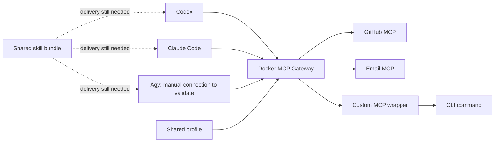

# Docker MCP Gateway: fit for the onesrc hub sketch

Date: 2026-10-30. Status: research, not an adoption decision.

Read alongside [the product discussion](2026-10-30-product-direction.md).
This assessment distinguishes documented behavior, source observations, and
recommendations. Sources target moving `main` branches and current docs, not a
pinned release. Recheck the installed version before using examples.

## Assessment

Docker already implements much of the sketch's MCP hub: agents connect to one
gateway configuration, which routes to configured backends. It is a strong
candidate for the execution layer. It does not establish the complete product
the user described: shared skills/instructions, arbitrary CLI adapters, and
provider-neutral actions remain separate concerns.

Recommendation: evaluate Docker as an existing backend before writing a new
gateway. Keep onesrc's role conditional on demonstrated gaps.

## Components and architecture

- Catalog: available server definitions.
- Profile: selected servers and their settings for a task or project.
- Gateway: runtime proxy between agents and selected servers.
- Toolkit: Docker Desktop interface for managing the setup.

Docker documents both containerized and remote backends. This removes repeated
per-provider setup across clients, although every client still needs a gateway
connection. See [Docker's product overview](https://docs.docker.com/ai/mcp-catalog-and-toolkit/).



Discovery aggregates backend `tools/list`; execution forwards `tools/call` and
returns its result. These are tool routing operations, not natural-language
planning or provider-neutral action translation.
[Message-flow documentation](https://github.com/docker/mcp-gateway/blob/main/docs/message-flow.md).

## One configuration versus one process

Two deployment shapes matter:

| Shape | Behavior | Evaluation consequence |
|---|---|---|
| stdio | Agent launches `docker mcp gateway run --profile <id>`. | Each client can launch a separate gateway process using the same profile. Do not assume one shared runtime/session. |
| HTTP streaming | Run a gateway once; multiple clients connect. | Closer to the literal shared box in the sketch; client auth and endpoint compatibility must be tested. |

The repository documents multi-client SSE/streaming operation, CLI tool
listing/inspection/calling, profile tool allowlists, and local database-backed
configuration. Project license is MIT.
[Repository README](https://github.com/docker/mcp-gateway).

Example runtime commands, not executed here:

```bash
docker mcp gateway run --profile onesrc-eval
docker mcp gateway run --profile onesrc-eval --port 8080 --transport streaming
```

Gateway docs also describe watch mode, optional long-running usage patterns,
and Desktop-independent operation with a Docker engine.
[Gateway operations](https://github.com/docker/mcp-gateway/blob/main/docs/mcp-gateway.md).

## Fit against the three use cases

| User case | Docker supplies | Remaining work |
|---|---|---|
| Send email | Shared access to a configured email MCP backend. | Select provider; authenticate; verify send tool/schema and result handling. Gmail/Outlook/Resend are different products and contracts. |
| Open PR | Route to GitHub MCP, configured once. | Branch preparation/push, repo permissions, description conventions, and duplicate handling remain workflow concerns. |
| Load skills | Gateway can relay ordinary MCP resources/prompts. | No native shared skill lifecycle or cross-client skill activation was established from the Docker docs inspected. Need explicit verification or an additional skill layer. |

The official Resend server documents remote and local MCP access and email
operations. This is one candidate backend, not evidence of a tested Docker
integration or a substitute for access to the user's existing mailbox.
[Resend MCP](https://github.com/resend/resend-mcp).

Docker's catalog includes `github-official`, with PAT configuration and GitHub
OAuth metadata. The upstream server exposes `create_pull_request`, including
owner, repo, base, head, title, body, and draft fields. The gateway does not need
to implement PR creation itself.
[Docker entry](https://github.com/docker/mcp-registry/blob/main/servers/github-official/server.yaml),
[GitHub MCP tools](https://github.com/github/github-mcp-server).

## CLI support: direction matters

1. **CLI calling MCP tools:** documented through `docker mcp tools ...`.
2. **Agent calling arbitrary CLI tools through the gateway:** requires an MCP
   interface around those commands; running a command does not make it MCP.

The server-entry specification's `command` field describes arguments for a
containerized server. It is not a declaration of arbitrary host functions with
automatically generated schemas. Definitions also support remote endpoints,
declared secrets, mounts, and configuration.
[Server-entry specification](https://github.com/docker/mcp-gateway/blob/main/docs/server-entry-spec.md).

For example, a `gh` adapter would need to define input/output contracts, invoke
`gh` in its intended environment, and translate failures. Container execution
also changes access to the host checkout and existing CLI authentication. That
is adapter work even when Docker handles lifecycle and routing.

## Standard protocol versus standard action

This is the main product decision still unresolved:

```text
Docker-style aggregation:
agent -> tools/call(provider_tool, provider_arguments) -> backend

Optional onesrc action facade:
agent -> email.send(common_arguments) -> adapter -> chosen provider
```

Docker's gateway does not, by aggregation alone, guarantee interchangeable
Gmail/Outlook/CLI schemas or uniform result semantics. If the user's standard
format means MCP requests, Docker substantially covers that requirement. If it
means backend-independent actions, an additional mapping layer is needed.

## Skills: an additional standards path exists

An official MCP Skills extension now documents `io.modelcontextprotocol/skills`,
`skills/list`, and `skills/get`, with files served through resources. This is a
possible interface for a shared skill service. Extension existence does not
prove Docker relays it or any of the three clients activates it. Ordinary
resource support alone does not establish native skill support.
[MCP Skills extension](https://skills.extensions.modelcontextprotocol.io/).

An evaluation should distinguish:

- Reading `SKILL.md` on explicit request.
- Discovering skills by metadata and triggering the correct one.
- Resolving relative references to bundled files.
- Running bundled scripts in the intended environment.

Fallback options: install bundles in client-native locations, or expose explicit
skill-discovery/read tools through a custom MCP server. Neither automatically
makes agent-specific tool references portable. Shared global instructions still
need a deliberate delivery mechanism.

## Agent connector observations

| Client | Evidence inspected | Finding |
|---|---|---|
| Claude Code | Embedded client definitions | Named system and project connector entries exist. |
| Codex | Dedicated Go handler and connect dispatch | Named connector exists; Docker's connector supports global configuration only. |
| Agy / Antigravity | Embedded client definitions and supported-client construction | No named connector found in the inspected sources. Manual connection needs testing; this is not evidence that MCP interoperability is unsupported. |

Gemini CLI has its own entry; do not treat it as evidence for Agy's paths.
[Client definitions](https://github.com/docker/mcp-gateway/blob/main/pkg/client/config.yml),
[supported-client construction](https://github.com/docker/mcp-gateway/blob/main/pkg/client/config.go),
[connect dispatch](https://github.com/docker/mcp-gateway/blob/main/pkg/client/connect.go).

Specific Codex connector limitation: the inspected handler resolves
`~/.codex/config.toml`, without consulting `CODEX_HOME`, and parses/marshals the
entire TOML document before writing. Inference: comments/formatting are not
preserved through that path. This differs from onesrc's planned byte-preserving
edits. This finding concerns Docker's connector, not the gateway protocol.
[Codex handler source](https://github.com/docker/mcp-gateway/blob/main/pkg/client/codex_handler.go).

## Credentials, isolation, and runtime policy

Docker's security model documents server-scoped credentials, no blanket host
environment inheritance for containers, resource limits, mount restrictions,
and bearer authentication by default for HTTP transports. Network egress is
not globally blocked by default. Container isolation is therefore not a promise
that enabled tools cannot perform external writes. Tool-name collisions are
rejected rather than silently resolved.
[Security model](https://github.com/docker/mcp-gateway/blob/main/docs/security.md).

The generated run reference lists `.env` secret lookup as an alternative to
Desktop secrets, interceptors, tool selection, static/long-lived modes, and
`MCP_GATEWAY_AUTH_TOKEN` for HTTP authentication. Defaults include 1 CPU and
2 GB memory limit per server, not a claim about actual usage.
[Run flags](https://github.com/docker/mcp-gateway/blob/main/docs/generator/reference/mcp_gateway_run.md).

For onesrc, central backend execution could remove the need to export provider
credentials into each agent. Agent-to-gateway authentication remains a separate
connection concern. No gateway-wide exactly-once email sending, durable retry
ledger, or per-action user approval workflow was established in this research.
Those behaviors must be verified or implemented only if needed.

## Dynamic discovery and composition

Docker documents session-local discovery/add/remove/configuration tools and
`mcp-exec`. Dynamically added servers do not persist into profiles. Code mode
can compose MCP calls, but Docker explicitly describes it as experimental and
not reliable for general use. Do not base required workflows on it without
testing.
[Dynamic MCP documentation](https://docs.docker.com/ai/mcp-catalog-and-toolkit/dynamic-mcp/).

Static profiles are the simpler initial evaluation: choose known tools and
compare behavior across clients before introducing runtime tool discovery.

## Setup, portability, and documentation caveats

Current CLI docs mark the feature Beta and specify Desktop 4.62+ for their
commands. Profiles can be exported/imported or shared as OCI artifacts;
credentials are excluded and configured separately.
[CLI guide](https://docs.docker.com/ai/mcp-catalog-and-toolkit/cli/).

The gateway is open source; Docker also has a distinct invite-only AI Governance
offering. Manual plugin installation for Docker Engine is documented, so a
Desktop-only product assumption would be incorrect.
[Gateway availability and installation](https://docs.docker.com/ai/mcp-catalog-and-toolkit/mcp-gateway/).

The inspected repository profile guide warns that MCP Registry references are
not fully implemented, while other documentation lists them as reference
options. Treat that route as unverified. Feature-enabling guidance also varies
across docs; validate against the chosen release.
[Repository profile guide](https://github.com/docker/mcp-gateway/blob/main/docs/profiles.md).

## Smallest useful validation

This is a proposed exercise, not work already executed:

1. Pin the plugin version and backend versions. Use a disposable profile and
   fixture client configs before testing real-home connectors.
2. Add GitHub and one chosen email provider. Configure credentials once.
3. Connect all three agents to the same profile; test discovery and harmless
   reads first. Record manual setup needed for Agy and custom config homes.
4. Compare stdio and shared HTTP behavior, including stateful sessions,
   concurrent clients, missing credentials, and client restart behavior.
5. In explicitly authorized test destinations, send one email and open one draft
   PR through each client. Verify returned identifiers and failure behavior.
6. Serve one skill with a referenced file and a harmless helper script. Determine
   what each client discovers, reads, and can execute without custom guidance.
7. Wrap one CLI operation only if that capability is still required. Compare
   wrapper effort with using an existing MCP server.

Success means redundant provider setup is removed across agents, with remaining
skill/CLI/connector work measured rather than assumed.

## What this means for onesrc

| Possible direction | Assessment |
|---|---|
| Adopt Docker directly | Best if shared MCP setup solves enough pain and skills can stay in existing native locations. |
| onesrc config/skill layer + Docker runtime | Plausible if import, safe client connection, skill delivery, and shared instructions remain useful gaps. |
| onesrc action facade + Docker runtime | Plausible only if provider-neutral requests are explicitly required. Adds mapping and execution semantics. |
| Build another generic gateway now | Not justified by this research; Docker already overlaps substantially. |

Do not combine every possible direction into an initial release. Validate the
three use cases, then choose the smallest layer that removes remaining setup.

## Local evidence and limits

Read-only local checks found Docker CLI 29.5.0. `docker mcp version` returned
`docker: unknown command: docker mcp`. No plugin was installed, no Docker
containers were started, and no agent configuration or credentials were changed.
Gateway behavior was not tested locally. Source inspection was through web
fetches; shell access to GitHub failed DNS resolution. This is documentation and
source research, not an end-to-end validation report.
